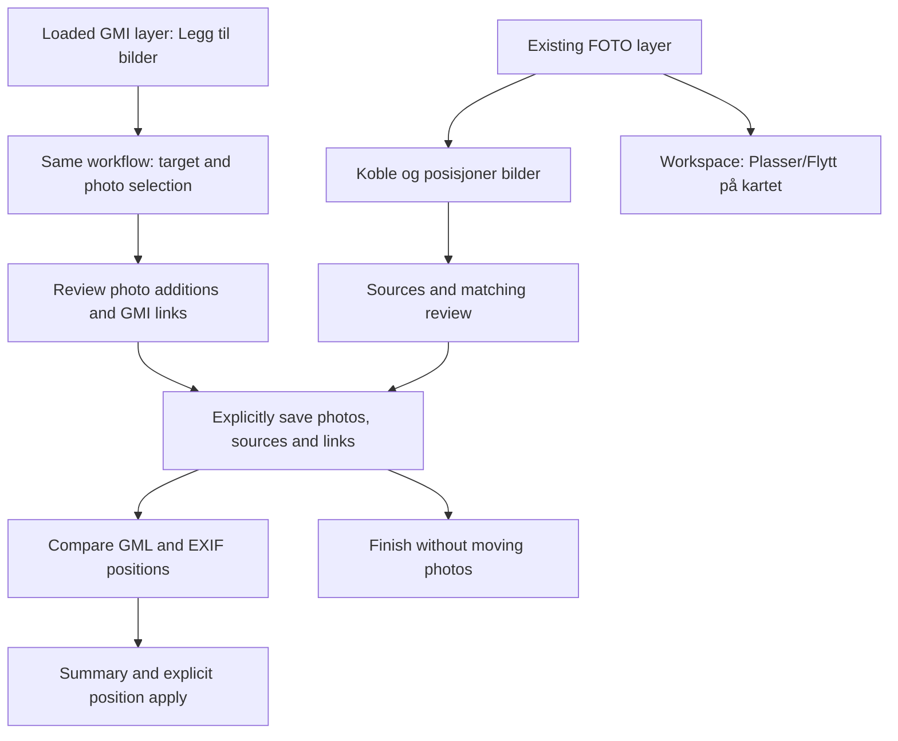

# Unified photo source workflow — planning

Date: 2026-10-19. Repository: `C:\GitHub\gmi-validering-test`. Branch: `feature/photo-workspace`. Audited HEAD: `7ae55f1`, with parents `710828d` and `45afd0f`.

This is a planning document. Production code, tests, dependencies, private fixtures and `data/usage/aggregates.json` were not changed. No implementation, commit, push or delegation was performed. Current code governs where historical reports describe superseded workflows. No new runtime acceptance results are claimed in this pass.

## 1. Executive recommendation

Replace the separate positioning wizard and GMI association dialog with **Koble og posisjoner bilder**. Use the existing positioning dialog shell, with four stages: **Kilder → Koblinger → Posisjoner → Oppsummer**. Matching runs within the first two stages; analysis and confirmation do not need their own permanent steps. Starting from a GMI layer adds photo selection within Kilder, rather than a second wizard.

Use one continuous workflow with two clearly labelled commit boundaries:

1. **Keep photos, source evidence and object links.** Explicitly confirm a new/rechecked external source. For the GMI entry path, creating/appending the curated photos and retaining that GMI source/its associations happen atomically here. No current photo position or direction changes.
2. **Apply selected positions.** Review all available GML/EXIF evidence, select exactly one proposed position per affected photo, then explicitly confirm the selected changes. This is a second atomic operation. The user never has to return to the workspace between the two operations.

The footer and a persistent saved-status message must explain the boundary. Before the first save, Avbryt discards the draft. Afterwards, Lukk preserves saved photos/kilder/koblinger and discards only unconfirmed positioning choices. Do not imply that closing rolls back an already confirmed import or association.

Support multiple sources in the workflow, but **one new/rechecked external source per matching confirmation**. Sources accumulate on the FOTO layer and all relevant position evidence is visible together. Users can add another source inside the same dialog. This avoids a complicated multi-file transaction while allowing GMI → EXIF and GMI → GML → comparison without leaving the workflow.

For GMI-layer entry, default to a new FOTO collection, offer an explicit existing target, and reuse the exact loaded GMI input/parse through a new source binding. Do not ask for that GMI file again. Never infer photo position from GMI geometry.

Recommend **two browser-testable implementation slices**: first complete the unified FOTO workflow and retire duplicate source controls; then add the exact-revision GMI-layer entry, photo selection and creation/append transaction. Cleanup belongs inside each slice, not in a later milestone that leaves parallel workflows behind.

## 2. Current workflow audit

### Code evidence

| Area | Current implementation and implication |
| --- | --- |
| Positioning wizard | [PhotoPositioningWizard.js](../../src/components/photos/PhotoPositioningWizard.js): Kilde/Kontroller/Oppsummer; GML or EXIF per run; GML file or retained source; alternatives shown as comparison only. GML apply closes the dialog. |
| GMI dialog | [PhotoGmiDialog.js](../../src/components/photos/PhotoGmiDialog.js): separate picker, analysis, summary and association-only confirmation; closes on success. |
| Workspace collection | [PhotoWorkspaceCollection.js](../../src/components/photos/PhotoWorkspaceCollection.js): two main buttons, separate GML/GMI source histories and separate modal state. Both dialogs share the layer's single `sourceReviews[layerId]` slot. |
| Inspector | [PhotoSpatialInspector.js](../../src/components/photos/PhotoSpatialInspector.js): current position, manual controls, direction, GMI associations, evidence details, candidate zoom and direct `acceptCandidates` buttons. These direct source-position buttons bypass the wizard. |
| Import/append | [PhotoCollectionDialog.js](../../src/components/photos/PhotoCollectionDialog.js): multi-file image input/drop, optional GML input/drop, incoming-only curation and duplicate overrides. No folder input. GML may initialize positions at creation/append. |
| Session | [photoSession.mjs](../../src/lib/photos/photoSession.mjs): private original Files/resources; owner FOTO layers; one draft; source staging/recheck/cancel; separate association and positioning applies; generation/current/membership guards. |
| Source evidence | [gmiPhotoSource.mjs](../../src/lib/photos/gmiPhotoSource.mjs): full-byte GMI identity, object/member evidence, many-to-many associations, no position entries. [terrainPhotoGml.mjs](../../src/lib/photos/terrainPhotoGml.mjs): verified Terrain profile, immutable position evidence. |
| Map upload | [FileUpload.js](../../src/components/FileUpload.js), `useFileLoader`: parses uploaded GMI and passes only `fileMeta` plus parsed data to `addLayer`. GMI normally uses `FileReader.readAsText(..., 'ISO-8859-1')`. |
| Map layer | [store.js](../../src/lib/store.js), `addLayer`: returns layer ID; retains file metadata, parsed dataset, filters/analysis, display state. No original File/bytes or GMI byte fingerprint is retained. |
| Layer entry/actions | [LayerManager.js](../../src/components/LayerManager.js), [LayerPanel.js](../../src/components/LayerPanel.js): survey cards expose visibility, zoom, delete, expanded analysis/filter/table actions; no GMI → photos action. [PhotoLayerCard.js](../../src/components/photos/PhotoLayerCard.js) opens Bildemodul. |
| Runtime revision | [datasetRevision.js](../../src/lib/validation-v2/datasetRevision.js): opaque WeakMap identity for a dataset object. [objectRef.js](../../src/lib/validation-v2/objectRef.js): layer/revision/geometry/index locators. Neither is an original-byte fingerprint. |
| Shared hyperlinks | [hyperlinkFilenames.mjs](../../src/lib/hyperlinkFilenames.mjs): production copy exports and undeduplicated occurrence evidence coexist; retain this single grammar implementation. |

### Current domain and transaction details

- `makeSource` creates an owner-session source ID. GMI fingerprints are SHA-256 over original bytes, or exact hexadecimal bytes without Web Crypto. GML currently fingerprints normalized parsed evidence via `makeSource`, not necessarily raw XML bytes. Do not silently redefine GML deduplication while adding the GMI bridge.
- GMI source `references` get the session source-ID prefix. Object keys use a unique normalized GUID within that source, otherwise geometry scope/source index. Edges encode source ID + object key + photo ID. The source fingerprint and runtime IDs have different purposes.
- `applyGmiAssociations` checks explicit confirmation, exact staged ledger identity, source ID, current membership and recheck liveness. It updates retained source/association state without writing photo records. Empty/unmatched/ambiguous sources can be retained.
- `applyLayerSource` attaches GML evidence without accepting current positions. `applyPhotoPositioning` currently combines staged GML attachment with selected position acceptance, or accepts EXIF, and requires nonempty requests. `acceptCandidates` is a lower-level, partially accepting helper and lacks the complete wizard optimistic preflight; it is not the correct final unified batch transaction.
- `createLayer` and `appendImport` call `attachSource(..., true)` for an import GML. A confident GML match can become current at import confirmation. This is intentional existing behavior, but contradicts the new requirement to centralize source-position review. It must be deliberately migrated, not overlooked as an EXIF-only issue.
- Metadata completion adds EXIF evidence, never accepts it. Latest-record patches preserve preview, direction and current state. Initial direction is unknown (`null`), distinct from explicitly accepted north (`0°`).
- `sourceReviews` has one review per owner layer. A multi-source UI must not mount several independent source dialogs or overwrite this slot with concurrently active operations.

### Reports read and authority

The [first GMI source audit](20261008-gmi-photo-source-audit.md) explains raw lexemes, GUIDs, map feature indexes and the missing map/source binding. The [corpus audit](20261008-gmi-photo-corpus-audit.md) strengthens exact-revision requirements: 95 repeated GUID groups, two changed geometries, sparse/renumbered parser IDs and real many-to-many relationships. Its later association-only recommendation supersedes speculative earlier GMI-position suggestions.

The [GMI implementation report](20261008-gmi-photo-associations-implementation.md) documents the current association-only contract. The [workspace report](20261006-photo-workspace-implementation.md), especially its appended positioning-wizard and append corrections, supersedes its earlier inline attachment/batch UI. The [spatial report](20261006-photo-spatial-milestone-implementation.md) establishes GML/EXIF evidence and legacy import-time GML acceptance. The [manual-placement report](20261006-photo-manual-placement-implementation.md) and [direction report](20261008-photo-direction-implementation.md) define independent, guarded editing transactions. Preserve those domain boundaries while changing source UX.

## 3. Product principles

1. One place for external source matching, GMI links, automatic position comparison, selection and apply. A source type changes the evidence shown, not the overall journey.
2. Preserve six separate concepts: **photo asset, position evidence, accepted current position, GMI object association, direction, provenance**. A unified dialog is an orchestrator and projection, not a new authority for these records.
3. A FOTO layer is an explicitly chosen collection. It is not a disk directory, a GMI file, or an implied project namespace.
4. A match is not consent to move. Source attachment, metadata arrival, append, association recheck and map loading never silently accept source positions.
5. Source choice does not establish accuracy. GML and EXIF may disagree; a manually accepted current position remains authoritative until the user explicitly replaces it.
6. GMI objects identify referring objects, not camera locations. No Type, TEMA, nearest-object or geometry heuristic changes that rule.
7. Original files, raw link paths and source evidence remain unchanged. Display labels and normalized comparison keys do not become identity.
8. Cancellation and saved checkpoints must be understandable without knowing internal source or matching structures.

## 4. Unified wizard architecture

### Four stages and two checkpoints

| Stage | User task | State change |
| --- | --- | --- |
| **1 Kilder** | See the FOTO target and available sources. Add/use GML, GMI or built-in EXIF. In GMI-start mode choose target/photos here. | Stage reads/import draft only. No retained associations/current changes. |
| **2 Koblinger** | Review source contribution, filename matches, missing/ambiguous references and objects. Review curated photo additions in GMI-start mode. | Explicit source/photo checkpoint, if something is staged. |
| **3 Posisjoner** | Compare all available position evidence with current positions and choose proposed changes. GMI link counts remain visible as context. | Local proposals/selection only. |
| **4 Oppsummer** | Read place/move/same counts, source choices, exclusions and what was already saved. | Explicit atomic position apply, or finish without position changes. |

For EXIF-only entry or viewing existing evidence, stage 2 has no matching operation to save and may be skipped with an explanatory stepper state. A source-only GMI operation can finish after stage 2 or continue to positions. If no position is available, say so and offer GML addition or completion; do not require a meaningless position selection.

Keep one native dialog mounted. Inline source selection, matching details and photo picking are panels of that dialog, not nested GMI/GML dialogs. Generic photo-only import remains a collection task; its source shortcut leads into this same workflow, rather than another positioning UI.

### Multiple sources without a multi-source transaction engine

Choose option **B, with bounded operations**: all retained sources and position evidence are available in one run. Only one new/rechecked external source is staged at a time. After its source checkpoint, the user can choose **Legg til en kilde** and repeat Kilder/Koblinger without closing. Existing saved sources remain visible. A pending unsaved source must be kept or discarded before switching to another file.

This uses the existing one-review-slot architecture safely. It also gives a simple story when GMI succeeds but a later GML fails: GMI is saved; the GML has not been saved; the user can retry GML or use EXIF. Do not promise an all-source rollback.

Position review can select different retained GML/EXIF evidence for different photos in one final batch. This needs a general guarded candidate-acceptance transaction, not separate hidden calls to the current one-kind apply API. The default view stays simple through one row per photo and expandable alternatives.

## 5. Entry paths



Smallest discoverable entry set:

- FOTO workspace header: **Koble og posisjoner bilder** replaces both current source buttons. Available on an empty retained collection, because source-only attachment is useful.
- FOTO workspace **Legg til bilder** retains its collection purpose. After import, offer/open the central workflow for the target; it must not position during import. Opening it is navigation, not acceptance.
- One collapsed **Kilder og koblinger** section lists external sources plus EXIF availability. **Kontroller på nytt** opens the same wizard at that exact source. No separate inline apply controls.
- GMI layer's expanded action row in `LayerPanel`: visible text **Legg til bilder**, with a photo icon and accessible layer name. Keep visibility/zoom/delete header compact. Pass an explicit callback through LayerManager/Sidebar/page; do not select the legacy “current file” implicitly.
- Inspector: one contextual **Kontroller kilder og posisjon** link opens that same wizard focused on the photo and, where relevant, the source. It performs no source mutation by itself.

Do not add the same new operation to the global map toolbar, each feature popup, and multiple context menus in this milestone. The loaded GMI layer card is the correct source-scoped starting point. A FOTO card continues to open Bildemodul rather than acquiring several source buttons.

## 6. FOTO → source workflow

1. Open the central workflow with the exact owner FOTO layer and current membership. Show its name/count and source inventory.
2. Choose a GMI/GML file, a retained source, or EXIF already read from the photos. Once the loaded-source bridge exists, an explicitly chosen loaded GMI can also be used without another file picker. Existing sources are never implicitly reattached.
3. Analyse the primary source against that FOTO layer only. Show what it contributes: object links for GMI, photo positions for GML, GPS availability for EXIF.
4. Confirm **Behold kilde og koblinger** for GMI, or **Behold GML-kilden** for GML. For a retained source use **Oppdater koblinger** / **Oppdater treff**. GML evidence is attached without changing current positions. An unchanged recheck is an explicit no-op, not another source.
5. Continue directly to Posisjoner with GMI links now saved and all available GML/EXIF positions shown. Add GML within the same workflow if required. GMI-only evidence explains **GMI kobler bilder til objekter. Den gir ikke bildeposisjoner.**
6. Choose proposed source positions, review summary, and apply only selected rows. Or finish with associations/evidence only.

For GMI-linked photos with GPS, show **GMI: 2 objekter · EXIF GPS: posisjon tilgjengelig** and let the user review/apply EXIF immediately. No workspace return is necessary.

## 7. GMI layer → Add photos workflow

### Target and collection decisions

- Default target: **Nytt fotokartlag**, named **Bilder – <GMI filename without extension>**, editable before creation. Use the existing numerical suffix convention for collisions. The name is presentation, never source identity.
- Also offer **Eksisterende fotokartlag**, requiring explicit selection of a live target. Show name, member count and attached GMI filenames/source summaries. There is no trustworthy project ID today; do not claim the software can prove cross-project correctness.
- On choosing an existing target, show a concise confirmation of the named GMI and named FOTO collection. Matching still uses only that collection plus the accepted additions. An exact-byte GMI source already attached there is reused/rechecked, not duplicated.
- Changing target invalidates matching, planned additions and source confirmation. Preserve chosen file resources only as a draft, then recompute duplicate policy and matches for the new target. No automatic search across other FOTO layers.

### Expected flow

1. Capture the initiating map layer ID, runtime dataset revision and exact-source handle. Show **Bildereferanser fra <GMI filename>**. No GMI browse button is required for this context.
2. Choose target, then **Velg bildefiler** or **Velg mappe**. Only user-selected files are read. The GMI provides expected reference names/paths, not filesystem access.
3. Generate a preview against the prospective final owner membership, including existing target members and duplicate-safe additions. Show found selected images separately from references already satisfied by existing photos.
4. Review photo inclusion, missing/ambiguous references and object links. Confirm the photo/source checkpoint atomically.
5. Remain in the same dialog and continue to available EXIF/GML position review. Source GPS reads can finish asynchronously; no read completion accepts a position.

### Counts and inclusion policy

Show clearly separated counts: **Referanser funnet**, **Referanser med treff**, **Bilder med treff**, **Objekter med koblinger**, **Referanser uten bilde**, **Tvetydige referanser**, **Ugyldige referanser**, and **Ekstra valgte bilder**. Object count means distinct source-scoped objects, not references or assets. A repeated reference must not inflate “photos found”. Explain that “uten bilde” means not available in this chosen collection/selection, not proven absent from disk.

Default GMI-start curation includes images that are possible targets of at least one valid reference, including assets involved in ambiguous matches. Do not silently discard the ambiguity evidence. Selected photos with no possible reference match are extras; show them and default **Ta med ekstra bilder** off. The user may explicitly include them in the FOTO collection. They may have EXIF/GML positions even without GMI links. This policy is specific to the GMI-context journey; ordinary photo import still retains the curated incoming collection.

Unmatched/invalid/ambiguous GMI references are retained with the confirmed source. Zero matches is allowed, with an explicit **Ingen bilder ble koblet** summary. A collection containing explicitly included extras may still retain that GMI. An existing empty collection can retain the source. If creating a new collection with no included photos, do not create it via the ordinary photo-import button; offer an explicit **Opprett tomt lag med kilden** choice, explaining that photos can be added later. No source-only operation may masquerade as a successful photo import.

If no new photos will append but existing target members match, allow association-only confirmation. The existing `appendImport` zero-new restriction must not prevent this operation; do not add duplicate assets just to pass it.

### Files, folders and matching

- Reuse existing multi-file classification, preview, EXIF jobs, incoming curation and original-File ownership. Add a folder picker using the supported directory input capability and recursive relative paths; offer the multi-file picker as fallback. Folder drag recursion is not required for the first implementation.
- `importFiles` already records `file.webkitRelativePath`; the current dialog simply has no directory input. Preserve actual selected relative paths and root context. Never manufacture an original absolute path or pretend an arbitrary selected folder is the GMI's original Attachments folder.
- Retain the current resolver: collision-checked path, safe segment suffix, then unique owner-layer basename with case/NFC-aware buckets. Moved/flattened folders can match by basename. Do not require original disk layout.
- Duplicate basenames remain separate assets. Incoming versus existing-name collisions use the current default skip plus explicit **Legg til likevel**. Show why an incoming reference target would otherwise be skipped, and rematch after an override. Equal content does not authorize asset merging.
- Two folder roots containing the same relative name can still collide; preserve root labels as provenance and leave unresolved ties ambiguous. No nearest-object, hash-first, stem, extension, fuzzy or first-selected tie breaking.
- References into subfolders, bare filenames and `Pictures\Kum` must work through the established matching policy. Invalid directory-only references remain invalid. Unsafe reference paths do not trigger file traversal or network fetches.

## 8. Loaded GMI revision binding

### What exists and what is missing

`useFileLoader` retains name, size, lastModified, MIME type and detected format as plain metadata. The original File is local to the upload callback and is not retained by the map layer. No original byte buffer, exact-source fingerprint or durable upload identity is stored. `addLayer` produces a session layer ID. Parsed arrays retain GUID, parser ID, geometry and private raw field lexemes. The private symbol survives ordinary object reference sharing, but not JSON or the photo-domain `immutable` clone.

`getDatasetRevision(layer.data)` supplies a runtime object-identity guard. It is useful for rejecting a changed dataset but cannot prove byte equality. A filename, timestamp, GUID set or serialization of the processed dataset cannot replace the GMI exact-byte identity contract.

There is a further distinction: upload may add a user-selected CRS to `parsedData.header`/`crsContext`. The photo source must retain the original parsed header and field evidence before that display/interpretation enrichment. Never fingerprint enriched map state as though it were original input.

### Smallest safe addition

Add a private, session-only **loaded-GMI evidence registry**, reached through an opaque source handle. Keep raw resources out of Zustand/persistence. During GMI upload:

1. Read the original bytes once, use the existing `decodeGmiBytes` and `GMIParser`, and reuse that parse for both map output and association evidence. Change the GMI read branch to bytes; preserve SOSI/KOF behavior. Test decoding parity with the current browser ISO-8859-1 path, including BOM/Unicode/raw-lexeme cases. This is an input retention seam, not a new parser.
2. Compute the same full-byte fingerprint as `parseGmiPhotoSource`: `sha256:` or exact-byte fallback. Cache the canonical identity for this session so later consumers do not invent a second fingerprint representation. On failure, normal map loading need not fail, but this source-derived photo operation must be unavailable with a clear reason; do not substitute a weak identity.
3. Extract immutable original GMI evidence through a shared factory **before** CRS/header enrichment. Explicitly copy `GMI_SOURCE_LEXEMES` while available. Preserve original header, warnings/errors, point/line order, GUIDs, parser IDs, raw geometry and all hyperlink members.
4. Split the existing adapter into a byte/parse wrapper and that shared evidence factory. File-selected GMI and loaded GMI must produce equivalent base evidence. Do not reparse the original File on Add photos, scrape GeoJSON/popup strings, or write a map-specific GMI association parser.
5. Use `addLayer`'s returned layer ID and the final map dataset's runtime revision to register the binding to the captured original evidence. The temporary byte buffer can be released after identity/evidence are complete; retaining an original File forever is unnecessary. Retained photo sources hold immutable evidence independently of map-layer lifetime.

Apply the existing 10 MiB photo-source analysis limit to this capability without shrinking normal map-upload limits. For a larger GMI, show that photo reference analysis is unavailable under the current limit; do not reparse, truncate or silently analyse a subset. Failed/cancelled loads must release registry resources and never register an unowned handle.

Proposed metadata shape, not implementation:

```js
// Private registry entry; original bytes/Files never enter public state.
{ handle, fingerprint, originalEvidence, fileMetadata }

// Exact live-map binding carried with a retained photo source.
{ mapLayerId, datasetRevision, sourceFingerprint }

// Existing retained GMI photo source gains optional provenance bindings.
{ id, kind: 'gmi', fingerprint, objectsByKey, references,
  associationLedger, mapBindings: [/* bindings above */] }
```

Separate identities remain explicit: source fingerprint identifies original content; retained source ID scopes owner-layer evidence and edges; map layer ID + dataset revision identifies a live loaded instance. Existing object records already retain `geometryScope`, `sourceIndex`, parser ID and GUID for later navigation. Do not change validation ObjectRef contracts or build navigation now.

If identical bytes are loaded twice, one FOTO source may record both explicitly established map bindings rather than duplicate source evidence. Changed bytes with the same filename/GUIDs create distinct sources. Never silently bind a later map instance by filename or a global GUID search.

Layers loaded before this capture seam, or constructed programmatically without exact input evidence, cannot be promoted into a verified source by hashing `layer.data`. In this session-only app they normally disappear on reload. Require reloading the original map layer once to establish a verified handle; do not add a second GMI file picker inside the Add photos journey as an identity workaround.

## 9. Source semantics: GML / EXIF / GMI

| Source | Match/evidence contribution | Position contribution | Acceptance and direction |
| --- | --- | --- | --- |
| **GML – bildeposisjoner** | Original photo references, object/entry IDs, matching diagnostics, CRS/time/raw metadata | Valid matched photo positions, using existing verified Terrain parser and strict horizontal transform | Retaining the source creates evidence only. Explicit position confirmation changes current. Raw source direction does not update operational direction. |
| **EXIF GPS – fra bildene** | Per-asset read status and original GPS metadata; no source-file picker or layer-level GMI association | Usable per-photo GPS evidence, including questionable-zero warning where applicable | Never silently accepted. Pending/failed/absent/unsupported states remain distinct. No heading inference. |
| **GMI – objektenes bildereferanser** | Full source/object/member provenance; owner-scoped filename matches; many-to-many object links and unresolved references | **None** in this design, for any Type/TEMA/geometry | Association confirmation performs no position/direction writes and produces no fake position entries. |

Future source types declare supported contributions explicitly. Keeping sources in `spatialSources` is acceptable internally for now, despite its historical name. Select capabilities by source kind/capability, not by registry membership or the mere existence of geometry. A generic source result must be a discriminated position/association contribution, not every source coerced into GML `entries`.

## 10. Automatic positioning review design

One row per photo shows thumbnail/name, current position/source, proposed position/source, approximate movement, a selection checkbox and GMI referring-object count. **Posisjon** and **Objektkoblinger** are visually and semantically different columns/sections.

Each photo has zero or more available GML/EXIF positions, addressed by exact candidate ID and source ID. The proposal selector includes **Behold gjeldende**, individual source positions, and **Ingen posisjon tilgjengelig** when appropriate. For an unplaced photo, the unchanged choice means remain unplaced. Show original filename/source identity in expanded details so two GML sources cannot look like one indistinguishable “GML” option.

Recommended safe defaults:

- Unplaced photo with exactly one usable position: propose that position and include it in the review selection. This is only a proposal; explicit final confirmation is still required.
- Existing accepted position, including manual: default **Behold gjeldende**, no selected change. Provide an explicit **Foreslå GML for viste** / **Foreslå EXIF for viste** bulk operation that changes proposals only and is followed by summary/apply.
- Several usable positions: do not choose authority by arrival order, GML preference, proximity or GMI links. Require a source choice. Even coincident positions need an explicit basis choice before acceptance.
- Ambiguous source-to-photo matching does not produce an eligible position option. Other independent usable evidence, such as EXIF, remains available for that photo. A GMI ambiguity does not invalidate otherwise usable EXIF/GML.

Expanded comparison lists current coordinates, available source coordinates, differences from current and between alternatives, read/CRS issues, and which source currently supplies the accepted basis. Label **Ulike posisjoner fra kildene** when usable alternatives differ beyond the existing tolerance. This is a discrepancy, not an assertion that either source is wrong.

Keep `photoPositionDistance` and the existing 0.01 m comparison tolerance for continuity; show distances as approximate horizontal differences, never accuracy. Retain the “under 0,1 m” wording. States: **Plasseres**, **Flyttes ca. …**, **Samme posisjon**, **Ingen posisjon**, **Kan ikke brukes**, **Må avklares**. A same-position selection may change source basis and must be counted/explained explicitly.

The final plan contains no more than one request per photo, referring to the exact retained evidence and reviewed current record. Mixed GML/EXIF acceptance is one all-or-nothing batch. Evidence remains after acceptance. Do not average positions, modify GMI geometry, erase alternate evidence or change direction.

EXIF completion displays **Nye posisjoner er tilgjengelige – oppdater kontrollen**. It must not add rows to the selected apply set or change a chosen proposal silently. Metadata/thumbnail progress does not rewrite a reviewed current position. On explicit refresh, keep valid user choices by exact IDs and show newly available evidence as unselected if it changes an already reviewed decision.

## 11. Manual placement boundary

Manual placement stays exactly in the normal FOTO workspace: active photo → **Plasser på kartet / Flytt på kartet** → temporary map proposal → **Bruk plassering / Avbryt**. No map click, proposal dragging, manual coordinate editor or manual-placement step is added to the source wizard.

The wizard may show **Gjeldende: Manuell** and compare source positions with it. Replacement requires explicit selected-position confirmation. Opening any central modal cancels pending manual/direction proposals through the existing `onBeforeDialog`/page editor lifecycle; accepted values remain untouched.

This boundary follows the task: direct spatial judgement needs the primary map and one active image; evidence matching is a collection/source review. Combining both would obscure which action proposed the coordinates and complicate cancellation. Keep the map primary outside the dialog and keep manual tickets separate from source-operation tickets.

## 12. Transaction/staging model

### Checkpoint A: source/photo confirmation

For existing FOTO, preflight and atomically retain **one** source/recheck and its evidence or associations. For GMI-start create/append, additionally preflight and transfer the accepted draft asset IDs and attach/recheck the GMI against the final owner membership in the same publication. There must never be a visible half-created layer or append that succeeded while its promised GMI attachment failed.

Do not implement that operation by calling `createLayer`/`appendImport`, publishing, then calling `applyGmiAssociations` and attempting compensating deletion. Add a session transaction that validates first and prepares all affected records before any publication. Files keep their IDs and single owner on transfer; skipped/excluded draft assets and their URLs/jobs are released once. Existing target photos are never copied or removed by import curation.

Preflight includes session generation, draft token, live target identity/membership, initiating map binding when applicable, exact primary source identity/fingerprint, curated draft IDs, append overrides, and the reviewed matching result. If exact bytes already exist on target, reuse its source ID/confirmed endpoints and prepare a recheck rather than a second source. Zero-new/zero-match/source-only outcomes are explicit supported operations, not empty position applies.

For GML, reuse the candidate-only attachment behavior of `applyLayerSource`, with stronger operation-ticket/review validation. Disable `initializeCurrent` on all newly migrated import/append source paths. Drop/selection of GML alongside images should retain it as a staged source for the same workflow, not call a legacy import-position acceptance shortcut.

### Checkpoint B: selected current-position confirmation

Generalize the existing optimistic wizard apply into an API for requests referencing already retained candidate evidence, independent of one global source kind. Preflight every request against the live owner, exact current identity, exact candidate identity/eligibility and source liveness. Reject duplicate photo requests, removed sources/assets and stale source/membership versions. No partial updates. Prepare all changes, patch only `spatial.current` on the latest records, publish once and return applied IDs/counts.

The operation must not use the inspector's permissive partial-accept loop as its transaction. Retain lower-level APIs if existing tests/internal callers need them, but remove their direct product UI entry paths.

### Cancel and recovery contract

| Moment | Close/cancel result |
| --- | --- |
| Before source/photo checkpoint | Release owned draft resources; cancel reads; keep existing collection, sources, positions and direction unchanged. |
| After source/photo checkpoint, before position apply | Keep explicitly saved photos, source evidence and GMI links; discard local proposals only. Footer says **Kilder og koblinger er lagret. Posisjoner er ikke endret.** |
| Position apply rejected as stale | Keep saved source state and accepted current values; display reason, refresh review and require confirmation again. |
| After position apply | Retain selected current positions and all source evidence; close normally. |

Before checkpoint A use **Avbryt**. After it use **Lukk**, with **Fullfør uten å endre posisjoner** available. Do not label a saved checkpoint as temporary. Returning to earlier steps does not undo saved evidence; explicit source removal is the recovery operation. Parse failure retains an already staged valid source where current semantics allow recovery, but cannot mark the failed file as ready.

Only one central workflow operation owns a layer/draft at a time. Use an operation ID/ticket plus existing request counters, not disconnected React boolean dialogs. User target/membership/source changes invalidate plans. New metadata is not membership; handle it through explicit review refresh rather than repeatedly closing the dialog.

## 13. Recheck/removal lifecycle

**Kontroller på nytt** opens the same wizard with `{ ownerLayerId, sourceId, operation: 'recheck' }`, selects that retained evidence and recomputes owner-scoped matches. It never browses for the file again. Show what will change: new links/position evidence, unresolved references, ambiguity and already confirmed links.

Preserve the current GMI rule: confirmed live endpoints remain stable across append/recheck. New unmatched references may resolve on explicit recheck; append itself creates no GMI links. Removing a matched photo prunes endpoints but keeps the original reference; reducing an ambiguous set to one member still requires explicit recheck. Do not silently retarget an existing confirmed link to a newly imported same-name asset.

GML recheck updates matches/evidence without accepting current positions; the central position stages provide the optional next action. Existing GML ambiguous-reference policy remains stricter than GMI many-to-many associations. Pending EXIF completion is built-in metadata refresh, not another external source attachment.

One collapsed source-management area, reachable in the wizard, owns **Fjern kilde**:

- GMI removal confirms the filename and association count, removes only that owner's source/edges/indexes, and invalidates its staged operations. Photos, current positions, direction and the loaded map layer remain.
- GML has no general source-removal API today. If exposing it in the unified source manager, implement guarded removal: refuse while any current position uses that source, explain **Kilden brukes av N bilder. Velg en annen posisjon først.** Once unused, remove the source and its unused position evidence atomically, without changing current/direction. Do not leave dangling current-basis IDs or silently unplace/rebase photos. This is a new policy/API to test, not an existing behavior claim.
- EXIF is photo-owned evidence, not an attached external file to remove from a source list. No “remove EXIF source” action is introduced.

FOTO deletion/reset clears its source state and staged work. Survey map-layer deletion releases its registry binding but does not remove confirmed FOTO evidence or associations. Show **GMI-laget er ikke lastet** for that origin; do not disable its retained associations or require another import just to view them. Changed map data is a different binding, not permission to rewrite a saved GMI source.

If the initiating loaded layer disappears or changes before checkpoint A, reject that context-bound confirmation and ask the user to reopen from a live verified context. After A, the source is independently retained and position review can continue even if that map layer is removed.

## 14. Inspector implications

Keep the selected-photo inspector as the persistent explanation of working state:

- Accepted current position and basis, current-position zoom, and manual workspace controls.
- Direction, with unknown versus explicit north preserved.
- GML/EXIF evidence and source history, including read errors and source details.
- **Referert fra GMI**, distinct referring-object counts, useful identifiers, Type/TEMA, GUID, source filename, original reference and matching method in details.
- Image metadata, preview/lightbox and existing original-URL ownership.

Replace direct **Bruk EXIF-posisjon / Bruk GML-posisjon** buttons with the single central **Kontroller kilder og posisjon** action. Pass focused photo/source context, but do not pre-confirm a position or overwrite collection selection. Evidence coordinates may remain displayable; current-position zoom remains. Any retained evidence-zoom action must navigate only, never select/accept evidence implicitly.

Move recheck/remove controls into the shared source-management view. Inspector source links may open that view, but should not grow their own pickers, match lists, confirmation buttons or another wizard. Keep workspace active-photo and batch-removal selection independent of central position selection.

## 15. UI structure/layout

Adapt [photoPositioningWizard.css](../../src/components/photos/photoPositioningWizard.css): current width `min(1080px, 100vw - 48px)`, height `min(790px, 100dvh - 48px)`, fixed header/stepper/footer, one flexible content scroller. The separate GMI shell is narrower (`820px`, max-height `720px`) and can be retired. Reuse its summary component/content rather than its dialog.

Expected outer sizes from the current positioning shell:

| Viewport | Dialog width × height | Review arrangement |
| --- | --- | --- |
| 1680×900 | 1080×790 | Main list with optional approximately 300px focused detail pane. |
| 1366×768 | 1080×720 | Same shell; shorter list viewport, persistent footer. |
| 1280×720 | 1080×672 | Compact summary strips; details expand on request. |
| 1024×768 | 976×720 | Single-column list/cards with inline comparison; no squeezed permanent sidebar. |
| 1024×620 | 976×572 | Same single-column approach; vertical scroll only in content, actions always reachable. |

Do not force three internal panes into a modal already over the three-pane workspace. Kilder can use compact source contribution cards above the content. Koblinger shows a labelled summary strip, filtered reference/photo list, and expandable object detail. Posisjoner defaults to compact per-photo rows/cards; a wide-layout detail pane is optional, not required for task completion. A proper table is useful for desktop comparison, but row controls must remain keyboard-labelled and collapse without horizontal clipping at 1024.

Use one primary content scroll region. If a side detail pane is used, bound it independently only on wide screens; avoid nested scrolling inside every photo row. Keep header/stepper/footer outside the scroller. Long paths wrap; summary numbers do not push the action footer out of view. Use thumbnails already owned by the session; do not open original-image URLs for each comparison row.

Stepper shows current/completed stages and saved status. Back navigation to saved stages means review/edit a new operation, not unsave. Source/photo checkpoint buttons have descriptive verbs; normal Neste is navigation only. Native dialog focus containment, Escape semantics, focus restoration and accessible progress/status announcements must survive. Opening this workflow cancels temporary map edits and suppresses global file-drop handling through the existing modal integration. Map editing/navigation remains outside this workflow.

## 16. Recommended Bokmål labels

**Koble og posisjoner bilder** is the recommended workflow name because it names both concrete tasks. Posisjoner bilder promises only coordinates; Bildedata is too broad; Kilder og posisjon is suitable for a section but does not clearly express object linking; Bildereferanser og posisjon underplays GML/EXIF review. The longer task label is acceptable as one primary workspace action.

| Purpose | Recommended wording |
| --- | --- |
| Workflow / stages | **Koble og posisjoner bilder**; **Kilder**, **Koblinger**, **Posisjoner**, **Oppsummer** |
| GMI layer action | **Legg til bilder**; accessible name **Legg til bilder fra <lag>** |
| Target | **Nytt fotokartlag** / **Eksisterende fotokartlag** |
| Source choices | **GMI – objektenes bildereferanser**, **GML – bildeposisjoner**, **EXIF GPS – fra bildene** |
| Source actions | **Velg GMI-fil**, **Velg GML-fil**, **Bruk et lastet GMI-lag**, **Legg til en kilde** |
| Photo input | **Velg bildefiler**, **Velg mappe**, **Ta med ekstra bilder** |
| Matching | **Treff**, **Ingen treff i laget**, **Flere mulige bilder**, **Ugyldig referanse** |
| Match method | **Relativ sti**, **Del av sti**, **Filnavn**, with case/Unicode details expandable |
| Associations | **Koblet til 2 objekter**, **Venter på bekreftelse**, **Ingen objektkobling** |
| GMI explanation | **GMI kobler bilder til objekter. Den gir ikke bildeposisjoner.** |
| Position availability | **Posisjon tilgjengelig**, **Leser GPS …**, **Ingen GPS-data**, **Kan ikke brukes** |
| Position decision | **Behold gjeldende**, **Plasseres**, **Flyttes ca. …**, **Samme posisjon**, **Ulike posisjoner fra kildene** |
| Association checkpoint | **Behold kilde og koblinger** / **Oppdater koblinger** |
| GML checkpoint | **Behold GML-kilden** / **Oppdater treff** |
| New/append context checkpoint | **Opprett lag og behold koblinger** / **Legg til N bilder og behold koblinger** |
| Position confirmation | **Bruk valgte posisjoner for N bilder**, with singular wording when needed |
| No-position completion | **Fullfør uten å endre posisjoner** |
| Source management | **Kilder og koblinger**, **Kontroller på nytt**, **Fjern kilde** |
| Inspector entry | **Kontroller kilder og posisjon** |
| Saved state | **Kilder og koblinger er lagret. Posisjoner er ikke endret.** |

Internal `adapter`, `ledger`, `candidate`, `fingerprint`, runtime revision and source IDs do not belong in the ordinary flow. Prefer **posisjon fra …** or **tilgjengelig posisjon** to “kandidat”. Advanced provenance can show technical identity when useful, alongside filename and import time; do not ask users to choose a “source revision”.

## 17. Migration from current controls/dialogs

| Existing element | Recommended migration |
| --- | --- |
| Posisjoner bilder | Rename/extend into the one central workflow. |
| Koble GMI-referanser / PhotoGmiDialog | Remove its independent entry/state/dialog when the central GMI contribution is complete. Reuse summary/inspector components. |
| Velg GMI-fil | Keep inside Kilder for file-start FOTO entry. GMI-layer entry already supplies its exact source and does not request it again. |
| Bekreft GMI-koblinger | Replace with the explicit source checkpoint in Koblinger; success can continue directly to Posisjoner. |
| Separate Posisjonsdata/Bildereferanser histories | Consolidate under Kilder og koblinger, while preserving distinct contribution labels and counts. |
| GMI/GML recheck | Route to the central workflow with exact retained source ID. |
| GMI removal | Move into central source management; retain explicit generic confirmation and current association-only semantics. |
| Per-photo Bruk EXIF/GML | Remove direct apply. Open central focused review instead. |
| Import/append GML position picker/automatic current initialization | Migrate source selection/drop to central staging and explicit review. Photo-only import may finish first, then enter the central workflow. No parallel GML position-confirmation shortcut remains. |
| Manual placement / direction controls | Keep in the workspace, with the existing ticket/apply/cancel semantics. |
| Source details and candidate/current zoom | Retain explanatory display/navigation; no second mutation path. |

Do not rewrite already accepted positions when deploying this UI change. Current GML/EXIF/manual bases remain valid. No persistence migration is needed for photo state because it is session-only. Preserve historical APIs internally until direct callers/tests are migrated, then remove dead UI wiring in the same slice.

## 18. Domain/API changes needed

Names below describe proposed seams, not a mandate for a large abstraction framework.

| Change | Smallest responsibility |
| --- | --- |
| Shared GMI evidence factory | Build the same immutable object/reference evidence from the original production parse for both source entry paths; shared byte fingerprint helper. |
| Loaded-source capture/registry | Bind verified original evidence to map layer ID + final runtime dataset revision; remove registry entry on failed upload, deletion/reset. No file resources in Zustand. |
| Stage retained/loaded evidence | Extend staging to accept a verified evidence handle, not require a File; run the existing owner-scoped GMI matching. Untrusted arbitrary “parsed data + fingerprint” arguments are not an equivalent public contract. |
| Central workflow ticket | Own operation ID, generation, target/draft/source bindings and immutable review guards. Expose pending/saved state without copying photo authority into React. |
| Photo + GMI checkpoint | Preflight/create-or-append + source reuse/attach/recheck + associations, then publish once. Support zero-new source-only changes. Transfer original IDs/Files. |
| Candidate-only GML source checkpoint | Wrap existing attachment with explicit reviewed guards and no current initialization; source-only confirmation allowed. |
| Position review projection | Build choices from retained GML/EXIF evidence; compare current and alternatives; explicit per-photo choice and selection. No GMI-to-position coercion. |
| Guarded mixed-position batch | Validate all exact candidate/current/source identities first, then accept chosen current positions atomically, preserving all other latest fields. |
| Source inventory/removal | One contribution-aware selector; maintain GMI removal and add guarded GML removal only with the no-dangling-basis policy. |
| Named layer creation/folder curation | Add explicit name/target/curation options at the transaction boundary; reuse append duplicate policy and `webkitRelativePath` evidence. |

Keep matching mechanics in `photoReferenceMatching.mjs`; keep GMI repeated-reference policy in `gmiPhotoSource.mjs`. Keep source objects layer-owned and photos single-owner. Do not rename `spatialSources` across the repository merely for architectural tidiness. Capability-aware selectors and correct writer APIs are the necessary changes.

File-selected GMI and verified loaded GMI must both reach source-ID construction exactly once. Reusing base evidence must not double-prefix reference IDs. Reattaching the same bytes to another FOTO creates its own owner-scoped source identity/matching; one FOTO must not share another FOTO's ledger.

## 19. Implementation slices

### Slice 1 — Unified source and position workflow for existing FOTO

Deliver the four-stage shell, explicit source checkpoint, sequential source additions, integrated GMI/GML/EXIF evidence, mixed-position review/apply and focused inspector entry. Migrate import/append GML acceptance into central review; retain photo-only import curation. Consolidate recheck/source management and retire `PhotoGmiDialog`/duplicate apply buttons in this same slice. Implement and test the GML removal guard if removal is exposed; otherwise do not render a nonfunctional removal affordance.

Browser completion: existing FOTO → GMI confirmation → EXIF apply without leaving the dialog; GML evidence → explicit apply; GML + EXIF comparison; saved-source cancellation; unchanged manual/direction/lightbox/reset. The loaded-map GMI shortcut is not advertised until slice 2. This slice stands alone as a coherent replacement for the current split UX.

### Slice 2 — Loaded GMI → photos, exact identity and folder selection

First establish and test the original-byte/parse binding at upload and factory parity. Then add the layer action, new/existing target selection, file/folder curation, informative reference counts, atomic create/append + source/association checkpoint, and continuation into slice 1's position review. Include map-layer removal/change/reset lifecycle and duplicate-source reuse.

Browser completion: a loaded real GMI starts a FOTO collection without browsing for that GMI again, many-to-many links match the private corpus, and EXIF/GML can position the images afterwards. Existing-target append, extras/missing/zero-match/source-only cases and changed-revision guards are included, not postponed to an arbitrary cleanup slice.

Two slices give an early usable product while isolating the risky survey-upload/source-identity change. A third dialog-polish/cleanup milestone would prolong duplicate paths; routine polish and old-control removal belong to their corresponding completed slice. Future map object highlight/zoom, GMI-derived positions, export and persistence remain separate milestones.

## 20. Test/acceptance plan

### Existing evidence and fixtures

Use the existing [GMI domain tests](../../tests/gmiPhotoAssociations.test.mjs), [corpus acceptance](../../tests/gmiPhotoCorpus.test.mjs), [GMI browser tests](../../tests/gmiPhotoAssociationsUi.test.mjs), [positioning tests](../../tests/photoPositioning.test.mjs), [matching](../../tests/photoReferenceMatching.test.mjs), [workspace](../../tests/photoWorkspace.test.mjs), [append](../../tests/photoAppendDuplicates.test.mjs), [manual](../../tests/photoManualPlacement.test.mjs), [direction](../../tests/photoDirection.test.mjs), [reset integration](../../tests/photoResetIntegration.test.mjs) and current browser harness. Update UI expectations deliberately when removing old controls; preserve domain assertions.

Private acceptance inputs:

- GMI corpus: `C:\temp\gmi examples`.
- GML: `C:\Temp\gmi-photo-test\Ekenesstokken\20251120-bilder\20251120-Ekenesstokken-bilder.gml`, with its sibling Attachments collection.

Pin inventory and hashes before and after real-fixture runs. Never copy private fixtures into git or mutate them. Existing acceptance expectations are 12 GMI files, 1,386 objects, 303 occurrences, 302 confident matched references, one invalid directory target, 95 cross-source repeated GUID groups and two changed-geometry groups. Ekenesstokken provides 148 GML matches, independent EXIF evidence and 136 distinct locations. Those numbers describe known fixtures; fail/report a changed inventory rather than adapting assertions silently.

### Required scenario matrix

| ID | Scenario | Required acceptance |
| --- | --- | --- |
| A | Existing FOTO → GMI → EXIF | GMI checkpoint creates only links/evidence; next stages apply selected EXIF in the same dialog. |
| B | Existing FOTO → GML | Source checkpoint leaves even unplaced photos unchanged; only final selected-position apply places them. |
| C | GML + EXIF | Both visible together, discrepancy distances clear, per-photo source choice, mixed final batch atomic; no source priority guessed. |
| D | Loaded GMI → Add photos | No second GMI selection/parse; exact loaded revision bound; curated assets/source/links saved atomically; continue to EXIF/GML. |
| E | Missing referenced files | References retained with honest owner/selection scope; found/reference/object counts reconcile; later append/recheck resolves missing links. |
| F | Extra selected files | Extras named/countable, excluded by default in GMI-start mode, optionally included explicitly; no fabricated GMI links. |
| G | Duplicate basenames | Nested folders, case/NFC and equal-content copies stay distinct; safe path evidence can disambiguate; unresolved ties never first-win. |
| H | One object → seven photos | Real G04 seven-image object yields seven edges with full member evidence and sparse parser ID retained. |
| I | One photo → multiple objects | Real G01 shared photo retains both object edges; repeated same-object members group without evidence loss. |
| J | Repeated GUID across revisions | 95 real repeat groups remain source scoped; changed geometry/metadata/IDs do not rebind across revisions or duplicate map layers. |
| K | Cancel each stage | Before source checkpoint no retained changes; afterwards saved photos/links remain and positions do not change; late reads cannot resurrect drafts. |
| L | Recheck | Same central wizard/source ID; idempotent unchanged check; new matches explicit; confirmed GMI endpoints stable after duplicate append; GML current unaffected. |
| M | Manual current | Kept by default; compared with sources; stale position apply rejected after manual change; only explicit selected apply can replace it. |
| N | Direction | Known/unknown/north preserved through every source, import, recheck, mixed position apply and removal operation; latest direction not overwritten by async work. |
| O | No GMI geometry positioning | All Types, including DFOT/DOVG/empty, and point/line references produce association evidence only; zero GMI position candidates/requests. |
| P | No second GMI map layer | Source conversion never calls survey `addLayer`; map count/identity unchanged; GMI source removal does not delete survey layers. |
| Q | Existing FOTO regressions | Lightbox URL reuse, active/batch independence, marker/popup behavior, manual click/drag/keyboard/cancel, append policy, deletion/reset and metadata transfer pass. |

Additional integration cases: same bytes under another filename; identical source loaded in two map instances; changed bytes under the same filename; original versus user-supplied CRS headers; raw trailing lexemes; map filters/visibility not changing input identity; deleted/replaced initiating layer before/after checkpoint; existing target with zero new assets; explicit empty source-only collection; source-ID prefix parity; unsupported/large sources; absent secure-context Web Crypto; stale mixed batch causing zero writes; GML removal when in use/unused; EXIF arrival during review.

Test the shared factory against both parent entry paths with one parse counted/spied per map upload. Validate original-byte fingerprint, object ordering, raw lexemes, warning/error semantics and all hyperlink production exports. Do not weaken malformed-wrapper, copy dedup, directory-target or cycle handling to simplify the new UX.

### Verification execution by slice

- Run focused domain tests for the changed seams, plus hyperlink/table/popup copy, GML/EXIF projection, session, source lifecycle, manual, direction, append/reset and ownership regressions.
- Use existing production Chrome suites with `PHOTO_UI_URL`, `GMI_PHOTO_CORPUS` and `PHOTO_GML_FIXTURE`. Adapt source UI selectors, then add both entry-path flows and cancellation checkpoints. Keep 1680×900, 1366×768, 1280×720, 1024×768 and short-height checks; verify footer reachability, keyboard progress and source/position wording.
- Verify FOTO → AppInfo → Nytt → close retains the same photo/workspace; keep object-table inspection and survey popup behavior unchanged.
- Production build, targeted ESLint and diff/whitespace check for each completed slice. Compare failures with baseline rather than silently fixing unrelated shared-file issues.
- Baseline from the preceding post-merge verification: four stale source-contract failures in AppInfo/workspace inspector tests, pre-existing shared-file ESLint findings, and a default Turbopack Google Fonts resolver failure; Webpack production build and all ten browser acceptance tests passed. Reassess these facts at implementation time; do not claim a new green result by excluding or relabelling failures.

No runtime tests/build were rerun for this document-only planning pass. Validate the new report and ensure it is the only worktree change.

## 21. Risks and guardrails

| Risk | Concrete guardrail |
| --- | --- |
| Loaded GMI bytes do not correspond to retained evidence | Capture original bytes, parse and raw snapshot together before enrichment; shared factory; exact fingerprint plus runtime binding; parity/one-parse tests. Highest architectural risk. |
| GUID/file name mistaken for revision identity | Separate content fingerprint, retained-source ID and live-map revision; never global-GUID/file-name rebind. |
| Duplicate source attachment | Owner-scoped exact identity check; reuse source ID and confirmed endpoints; idempotent recheck; no double prefix. |
| GMI geometry accidentally creates photo positions | Explicit contribution discriminants; GMI has no position entries; position selectors/APIs reject it; tests cover Type and geometry varieties. |
| Attachment changes position/direction | Dedicated checkpoint writer, no `initializeCurrent`, latest-record field patches; identity-preservation assertions. |
| Unmatched references disappear | Retain all source occurrences/diagnostics; prune only live endpoints; counts reconcile; source-only attach permitted. |
| Append changes existing associations silently | Existing duplicate policy; no automatic GMI recheck; stable confirmed endpoints; exact prospective membership in reviewed checkpoint. |
| Cross-project existing FOTO selection | Explicit target name/source summary and confirmation; owner scope, no cross-layer search; acknowledge absence of a real project identity. |
| Wizard becomes a giant state machine | Four stages, one primary staged external source, two explicit checkpoints, contribution summaries and expanded details; one controller/operation ticket. |
| Stale target/source/draft/current apply | Session generation, operation/draft tokens, exact membership, source/map-binding liveness, expected-current/evidence guards; preflight all before publishing. |
| Manual state overwritten | Keep-current default, explicit replacements, summary of moves and same-position basis changes; no accepting during read/attach/recheck. |
| Two ways to apply the same source | Remove old dialog/direct inspector/import apply wiring in the slice that replaces it; one central focused entry from details. |
| Source removal leaves dangling basis | GMI removal association-only; GML removal blocked while in use; invalidate plans and remove unused evidence atomically. |
| Map layer disappears/changes | Reject an unsaved origin-bound operation; after confirmation retain FOTO evidence independently and mark live-map binding unavailable. |
| Hidden map/FOTO state conflated with source identity | Filters/visibility are display state; no source rewrite; manual visibility rules stay separate. |
| Save/cancel mental model unclear | Label source/photo checkpoint explicitly; persistent saved status; Avbryt before it and Lukk afterwards; no misleading rollback promise. |
| Async metadata changes selections | Announce new evidence, require explicit refresh, preserve valid exact-ID decisions; no silently expanded apply set. |
| Files/resources leaked or restored after reset | One draft/layer owner; registry cleanup hooks; generation guards; URL/job lifecycle tests; no persistence of Files or source handles. |

## 22. Exact recommended next implementation milestone

**Implement slice 1: a unified source and position workflow for an existing FOTO collection, using the current GMI/GML/EXIF domain separation.**

Its acceptance boundary is concrete: a user can attach/recheck GMI, see saved many-to-many links, continue to EXIF or add GML, compare available positions, and explicitly apply a selected mixed-source batch without leaving one dialog. Source-only completion and both cancellation checkpoints are clear. Manual placement/direction stay in the workspace. Old GMI dialog entry, inspector direct source apply and import-time GML position acceptance are migrated in the same delivery. Photo assets, retained evidence, accepted position, GMI links and direction remain separate.

Before writing that code, pin the new checkpoint/cancellation contract and mixed-position optimistic guards in focused acceptance scenarios. Do not build the loaded-layer shortcut with guessed identity as a shortcut to early UI delivery. Slice 2 then adds original-input capture, the shared GMI evidence factory and exact map binding, followed by the GMI-layer Add photos journey and its atomic target/curation transaction. No GMI position inference, map-object navigation, export or persistence is included in either slice.
