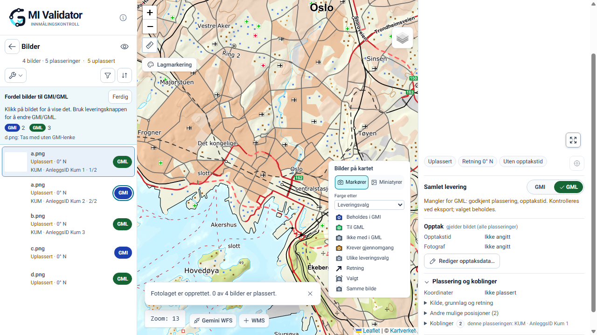
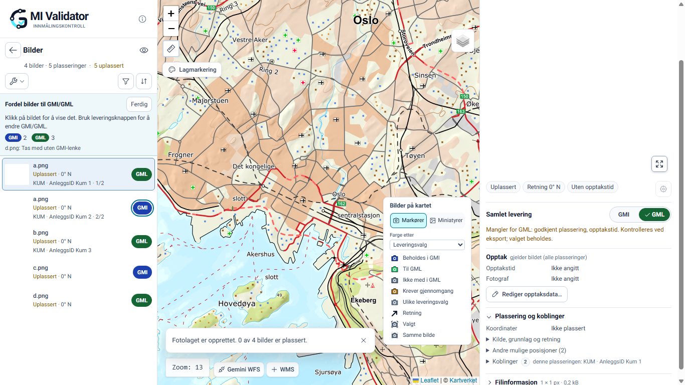

# FOTO sidebar navigation and destination-pill correction

Completed 2026-11-13 on `feature/photo-workspace`, starting and finishing HEAD `9d2ffd1`. Starting working tree was clean. Root instructions, development/privacy/security documentation and the direct-delivery-planning completion report were reviewed; no nested AGENTS.md files were found.

## Outcome and decisions

- Sidebar row, thumbnail and filename clicks now use the existing selection/navigation path in every mode, activating the exact placement in the inspector and retaining existing map navigation/highlighting. They never write delivery decisions.
- Planning mode adds a separate, sibling destination button. It calls only the existing toggle callback, which uses `photoDeliveryChoice` and the canonical M8 session actions for one occurrence. It stops click propagation and never selects a photo or requests map navigation. No nested buttons or additional decision state were introduced.
- Native buttons support keyboard activation. Each destination button names the filename, occurrence context, current decision and next action. The title explains the action or unavailable reason. Existing focus rings, hover darkening and a dashed unavailable border distinguish states. Unavailable buttons remain focusable for their explanation, with `aria-disabled` and a guarded handler.
- Outside planning, destination indicators remain read-only and normal navigation is preserved. Planning guidance now distinguishes navigation from editing. Inspector and map controls retain their existing semantics.
- Shared CSS destination tokens now use GMI `#1e40af` and GML `#166534`, both with white text/icons. Sidebar indicators/buttons, inspector and overlap toggles, occurrence-switcher pills and export-tree pills inherit these tokens. Borders and hover colours reuse the tokens. Selected options retain their checkmark and `aria-checked`; inactive/unavailable options do not gain a selected state.
- Combined GMI + GML tree pills retain a split fill, now using the two solid destination colours with white text. Exclusion, review and mixed-marker styles remain distinct. GML marker green remains `#22c55e` in the unchanged JS marker palette; a separate CSS marker token and parity test document that distinction. No marker shapes, arrows, counters or provenance colours changed.
- No changes to M8 semantics, M9 planning/packaging/source-byte patching, M10 guards, serializers, Validator or Rettinger. No dependencies added.

## Exact changed files

Application:

- `src/app/globals.css`
- `src/components/delivery/deliveryWizard.css`
- `src/components/photos/PhotoWorkspaceCollection.js`
- `src/components/photos/photoWorkspace.css`

Tests:

- `tests/deliveryWizardUi.test.mjs`
- `tests/photoDeliveryIntentUi.test.mjs`
- `tests/photoDeliveryPlanning.test.mjs`
- `tests/photoMarkerProvenanceUi.test.mjs`

Documentation: this report and six synthetic screenshots under `assets/20261113-foto-sidebar-destination/`, linked below. Extra generated screenshots were removed from this task's new asset directory.

## Verification

Passed:

- Initial focused command: `node --test tests/photoDeliveryPlanning.test.mjs tests/deliveryPolish.test.mjs tests/photoWorkspace.test.mjs tests/photoMarkerPresentation.test.mjs tests/photoDeliveryIntent.test.mjs tests/photoInspectorPresentation.test.mjs`: **61 passed**. After adding the cross-component palette assertion, `node --test tests/photoDeliveryPlanning.test.mjs`: **8 passed**.
- Final serial FOTO regression selection: all `tests/*.test.mjs` whose names start with `photo`, `delivery`, `gmiPhoto` or `gmiHyperlink`, excluding names containing `Ui` or `Layout`, passed to `node --test --test-concurrency=1`: **849 tests, 840 passed, 0 failed, 9 skipped**. Includes occurrence identity, unlinked inclusion/exclusion, blocked/review choices, M8-M10, package integrity and download protection.
- `npm.cmd run build`: passed, including a fresh final build after the navigation guidance correction. Existing Browserslist-age and module-type warnings remain.
- `npx.cmd --no-install eslint src/components/photos/PhotoWorkspaceCollection.js tests/photoDeliveryPlanning.test.mjs tests/photoDeliveryIntentUi.test.mjs tests/photoMarkerProvenanceUi.test.mjs tests/deliveryWizardUi.test.mjs`: passed.
- Production browser command: `node --test --test-concurrency=1 tests/photoDeliveryIntentUi.test.mjs tests/deliveryWizardUi.test.mjs tests/photoMarkerProvenanceUi.test.mjs tests/photoWorkspaceStacksUi.test.mjs tests/photoWorkspaceEditUi.test.mjs`: **56 passed, 0 failed, 0 skipped**. Used `PHOTO_UI_URL=http://127.0.0.1:3242` and `PHOTO_SCREENSHOT_DIR` pointing to this report's asset directory. The task's production server was stopped afterward.
- Added computed-colour assertions for overlap chooser/export tree and placed-marker sidebar navigation/highlighting, then reran `deliveryWizardUi` and `photoMarkerProvenanceUi` serially: **21 passed, 0 failed, 0 skipped**.
- Browser coverage includes 1280×720 and 1366×768, with additional narrow/mobile coverage; row/filename/thumbnail navigation without editing; button-only editing without selection or map movement; shared-photo independence; native Space activation; blocked line-only decisions; normal navigation outside planning; selected inspector pills; isolated-marker and overlap actions; export/download guards. Palette tests retain AA small-text contrast assertions and bright-marker separation assertions.
- The previously corrected inspector-stacks selector was rerun successfully: “inspector: portrait and landscape previews are large and uncropped; details stay available”. The entire stacks suite passed.
- `git diff --check`: passed.

Failed, separately:

The broader-than-required full serial run, `node --test --test-concurrency=1 "tests/*.test.mjs"`, returned **2,196 tests, 2,061 passed, 8 failed, 127 skipped**. This ran before the final extra palette assertion was added. Failures were:

- `appInfoUiContract.test.mjs:90`: working-header/conditional-feature source contract.
- `gmiRettingerSidebar.test.mjs:5`: Filter/Endringer source contract.
- `statsUiContract.test.mjs:8` and `:129`: statistics controls and trigger ownership source contracts.
- `validationV2WorkspaceInspector.test.mjs:7`, `:34`, `:103`: sidebar/workspace/map source contracts.
- `terrainPhotoGml.test.mjs:12`: dynamic import of the browser spatial-check module failed in its local harness.

These failures were not fixed or baseline-verified; this report does not label them pre-existing. Logs are in the task-local temporary files `foto-sidebar-node-tests.log`, `foto-sidebar-regression-tests.log`, `foto-sidebar-browser-tests.log` and `foto-sidebar-browser-extra.log` under the Windows temporary directory.

Skipped/deferred:

- The focused regression selection skipped 9 opt-in/private-fixture tests; the full run skipped 127 tests, including browser suites without their required environment and opt-in/private checks. Explicit production-browser runs above had no skips.
- The three previously unverified legacy export-browser failures in `photoAcceptanceRenderingUi` and `photoLoadedGmiUi` remain outstanding and were not investigated or rerun.
- No new real-file acceptance with the 117-photo/123-placement corpus, screen-reader session, Gemini import or private-corpus verification was performed. Synthetic automation does not replace those checks.

## Screenshots and visual review

Reviewed sidebar screenshots at both laptop sizes: navigation occupies the thumbnail/filename area, the destination button is separate, and the focused button remains visibly outlined while another placement stays active. Inspector GML is dark green with white text and checkmark. No horizontal sidebar/inspector overflow was observed. Marker/provenance regressions and solid/split export pills were also covered by browser assertions.

Additional retained evidence:

- [Inspector pills, 1280×720](assets/20261113-foto-sidebar-destination/m8-inspector-1280x720.png)
- [Inspector pills, 1366×768](assets/20261113-foto-sidebar-destination/m8-inspector-1366x768.png)
- [Planning map and vivid markers, 1366×768](assets/20261113-foto-sidebar-destination/refine-planning-map-1366x768.png)
- [Corrected inspector-stacks acceptance, 1280×720](assets/20261113-foto-sidebar-destination/pass1b-inspector-1280.png)

## Git and publication

Changes remain unstaged and uncommitted. No staging, commit, push, deployment, branch switch, synchronization or Git-ref changes were performed. The three named 20261111 reports were untouched. Scope deviation: the full serial Node suite was additionally run; its eight failures are recorded above without expanding the correction into unrelated investigation.
